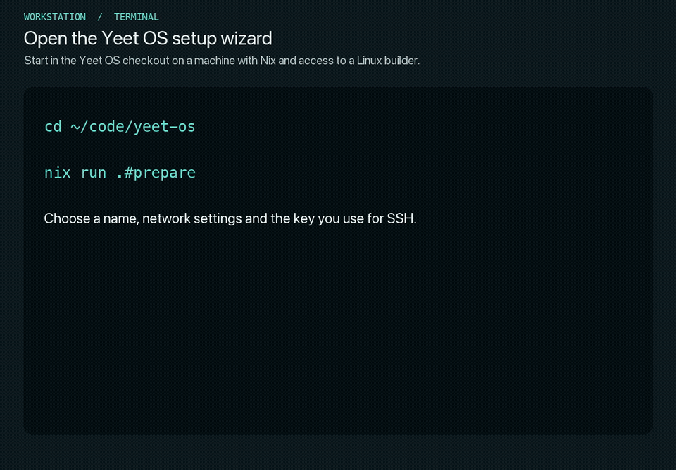

# Yeet OS

Yeet OS is a NixOS installer for machines you want to run apps on. If you already have a Linux server you like, install [Yeet](https://github.com/yeetrun/yeet) on it and keep your OS. If you’re setting up a dedicated box or VM, Yeet OS gives you the whole host, from the boot disk to the Yeet service.

Either way, you deploy from your laptop with the same `yeet run` command. On Yeet OS, Nix manages the machine and Yeet runs your apps. Shipping a new version of a script or container doesn’t require a Nix rebuild.

[](https://cdn.jsdelivr.net/gh/yeetrun/yeet-os@main/docs/yeet-os-walkthrough.mp4)

[Play the walkthrough with sound (1 min 42 sec)](https://cdn.jsdelivr.net/gh/yeetrun/yeet-os@main/docs/yeet-os-walkthrough.mp4)

## Install Yeet OS

You’ll need an x86-64 machine or VM with a disk you can erase. On your workstation, open the installer builder with Nix. A Mac can run the wizard if Nix has access to an x86-64 Linux builder.

```sh
nix --extra-experimental-features 'nix-command flakes' run github:yeetrun/yeet-os#prepare
```

Choose a hostname, your SSH public key, and DHCP or static networking. The wizard asks for a single-use Tailscale auth key and builds a private ISO. Boot the target machine from that ISO.

To open the disk menu, SSH to the hostname you chose. For example, if you named the machine `yeet-home`, run this from your workstation:

```sh
ssh -t root@yeet-home
```

The same menu opens on the machine’s console. Choose **Install a fresh host**, pick the disk for NixOS, and decide where your apps will live. Review the disk choices before you confirm. [Installation guide and Tailscale key setup](docs/install.md)

## Deploy your first app

After reboot, use the Yeet CLI on your workstation. Set the host to the name on the installer’s final screen, then deploy nginx and check that it serves a page:

```sh
yeet config --host=yeet-home
yeet run web nginx:alpine -p 8080:80
yeet ssh -- curl -fsS http://127.0.0.1:8080/
```

You can also point `yeet run` at a local script, a binary, or a Compose file. [Install the CLI](docs/install.md#deploy-a-payload) · [Payload reference](yeet-nix/website/docs/payloads/index.mdx)

## Replace a boot disk

If you keep Yeet’s host data and app files on separate ZFS data disks, you can replace the OS disk and bring the same Yeet host back. Shut down the old host, leave the data disks attached, and boot the installer. Choose **Recover an existing host**, import your pools, then select **Restore Yeet from my data disks**. The wizard shows which apps it found before you confirm the replacement disk.

[Watch the disk replacement (1 min 49 sec)](https://cdn.jsdelivr.net/gh/yeetrun/yeet-os@main/docs/legacy-migration.mp4) · [Supported storage layouts and recovery steps](docs/install.md#move-an-existing-yeet-host-to-a-new-ssd)

For a Proxmox disk image, instructions for updating the host, or the NixOS module for your own flake, see the [host guide](docs/host.md).
